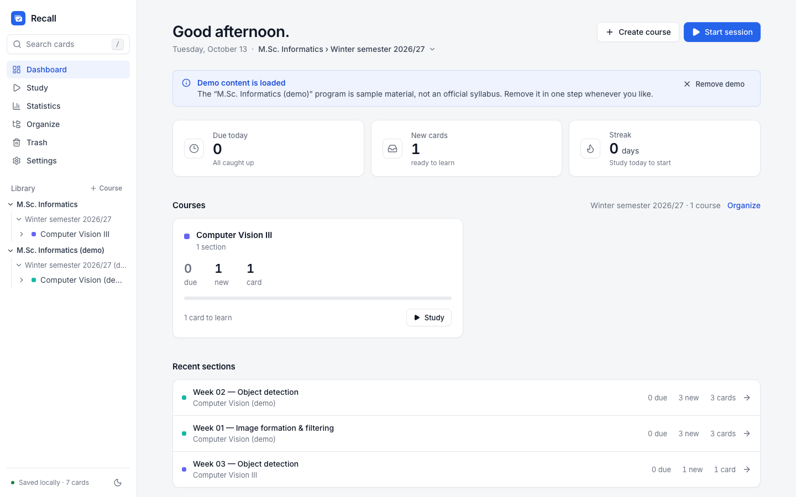
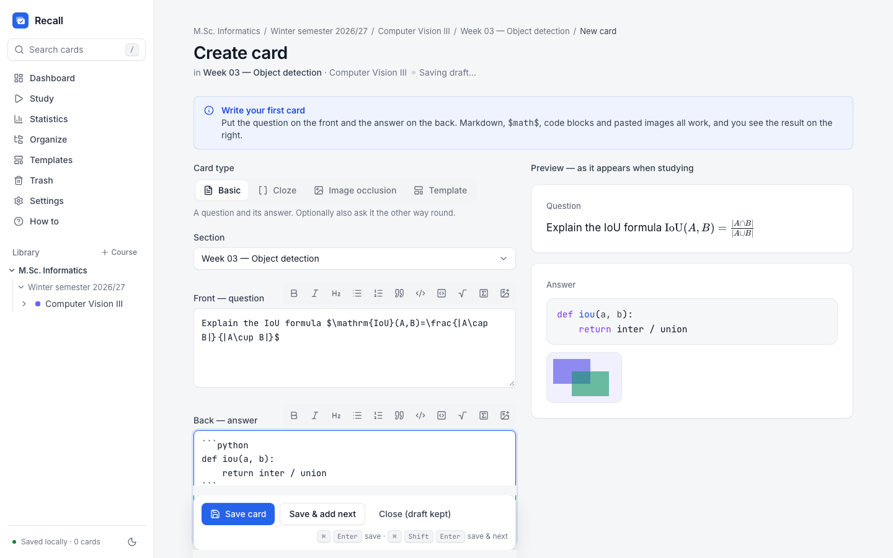
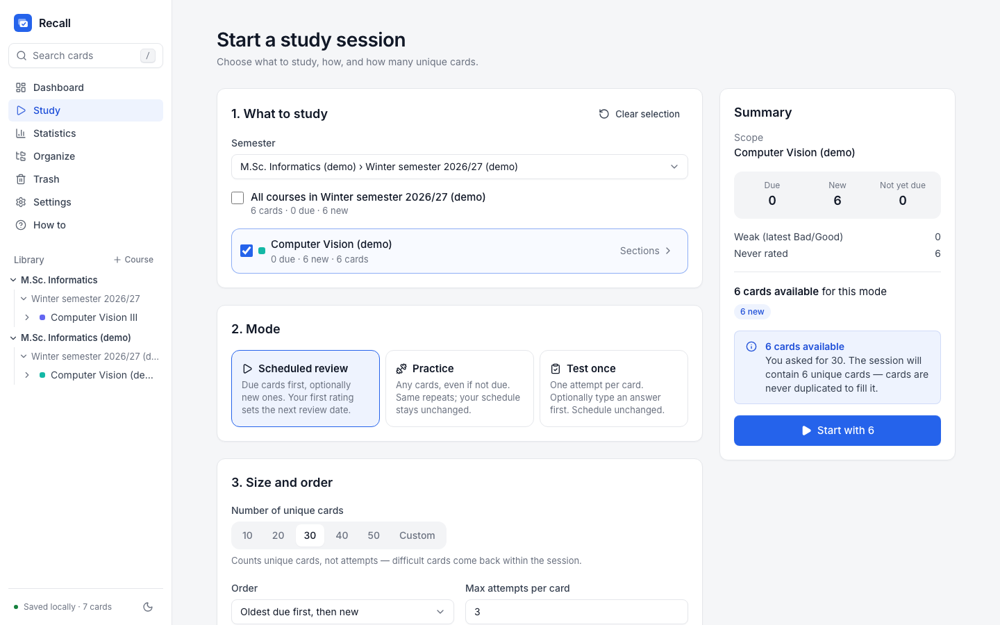
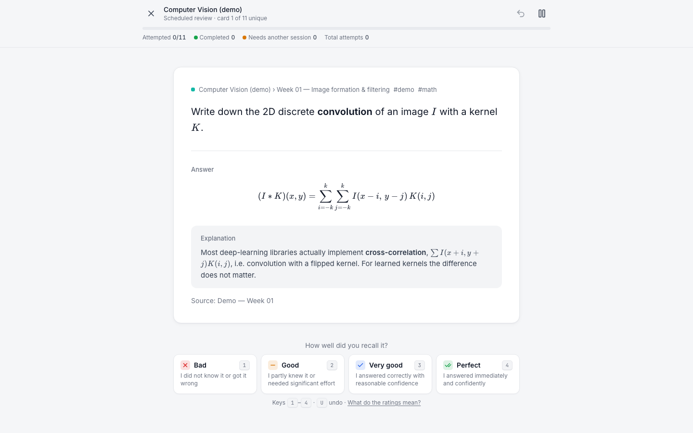
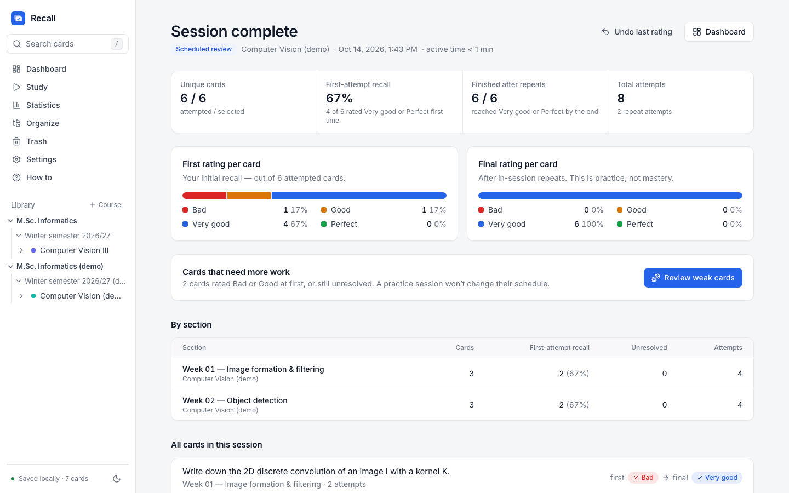
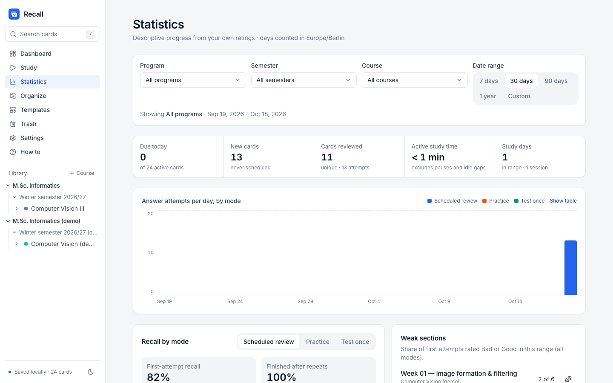
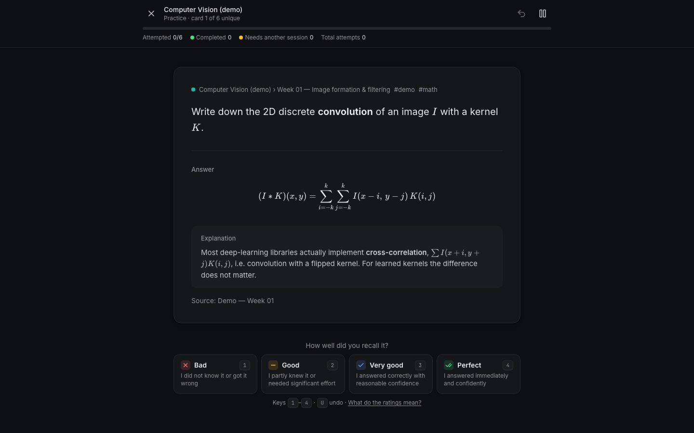
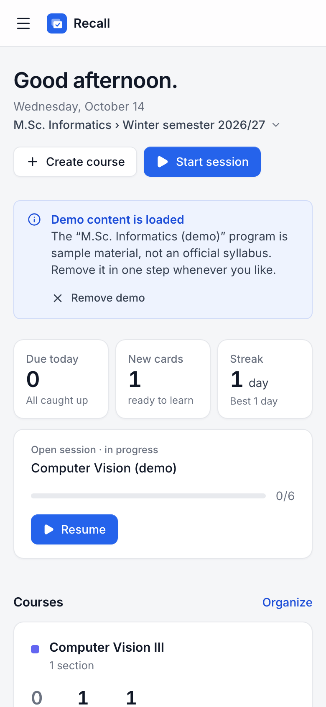
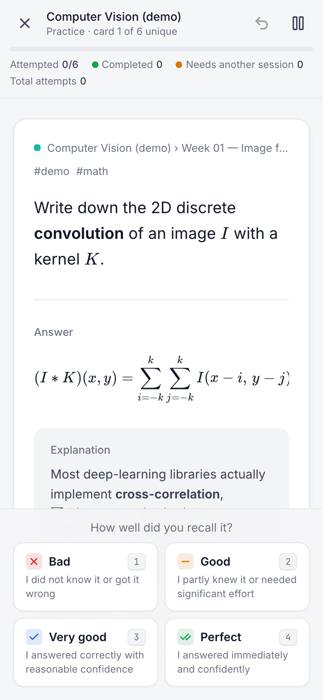
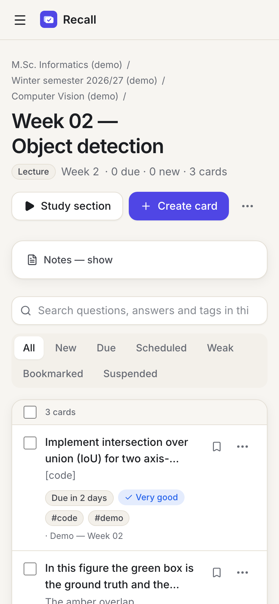

# Recall

A fast, private flashcard workspace for university study, running entirely on your own computer.

You organize **study programs → semesters → courses → sections → cards**, write cards with Markdown, LaTeX math, code and images, and test yourself in configurable sessions. Your four personal ratings (**Bad, Good, Very good, Perfect**) decide which cards come back within a session and when each card is due again.

- **No AI, no cloud, no account, no telemetry.** Nothing is ever sent anywhere.
- **Works offline.** After the one-time install and build, the app needs no internet connection.
- **Your data is a single SQLite database** in a folder you control, plus your uploaded images.
- **Plans toward your exams.** Set an exam date on a course to get a daily learn-and-revise plan plus plain-language readiness on the dashboard.



---

## Quick start

### 1. Prerequisites (once)

- **Node.js 22.18 or newer.** Node 24 LTS is recommended. Recall's server is TypeScript that Node runs directly, which needs Node ≥ 22.18.
  - On macOS with Homebrew: `brew install node@24`. The `node@24` formula is not linked by default, so add it to your PATH (for example in `~/.zshrc`):
    ```sh
    export PATH="/opt/homebrew/opt/node@24/bin:$PATH"
    ```
  - Check with `node -v`.
- Internet access is needed **only** for the install step below.

### 2. Install and build (once, and after updating the code)

```sh
cd /path/to/flashcard_app
npm ci          # installs exact versions from package-lock.json (needs internet)
npm run build   # type-checks and builds the frontend into dist/
```

`better-sqlite3` ships prebuilt binaries for Node 22/24 on macOS, Linux and Windows. If npm reports that install scripts were blocked, see [Troubleshooting](#troubleshooting).

### 3. Everyday use (offline)

```sh
npm start
```

Then open **http://127.0.0.1:4317**. When started from a terminal, Recall opens your browser automatically. The terminal prints the exact data folder in use. Stop the app with `Ctrl+C`.

Options:

| Option | Environment variable | Default |
| --- | --- | --- |
| `--port 5000` | `RECALL_PORT` | `4317` |
| `--data-dir /path/to/folder` | `RECALL_DATA_DIR` | see [Where your data lives](#where-your-data-lives) |
| `--no-open` / `--open` | `RECALL_NO_OPEN=1` | open the browser when run in a terminal |

Example: `npm start -- --port 5000 --data-dir ~/Documents/RecallData`

### First run

The database starts empty. The dashboard walks you through creating a program, semester, course and first section, and then opens the card editor. To look around first, choose **Load demo course**: a small Computer Vision course (equations, code, an image and a long answer) that is clearly labelled as demo material. You can remove it in one step from the dashboard or from Settings → Demo content.

### Built-in help

Open **How to** from the navigation for a fully offline, searchable guide to Recall. Its question-and-answer topics explain library setup, card creation, session modes and options, the four ratings, exam planning, statistics, organization, settings, backups and keyboard shortcuts. Answers link directly to the relevant screen where useful; no help content is fetched from the internet.

---

## Where your data lives

| OS | Default data folder |
| --- | --- |
| macOS | `~/Library/Application Support/Recall` |
| Linux | `$XDG_DATA_HOME/recall`, or `~/.local/share/recall` |
| Windows | `%APPDATA%\Recall` |

Inside it:

```
recall.sqlite        the database (+ recall.sqlite-wal / -shm while running)
media/               uploaded images, with generated file names
backups/             automatic snapshots (folder configurable in Settings)
tmp/                 short-lived restore/import staging files
```

The resolved paths are shown in **Settings → Data location** and printed at startup. The folder is outside the source tree and `dist/`, so rebuilding, reinstalling or updating the app never touches your data. The browser's local storage only holds disposable preferences, such as which sidebar groups are expanded. Unsaved card drafts are stored in the database too.

---

## Backups, restore and import

All of these are in **Settings → Backups & import**.

- **Export full backup** downloads a versioned `.zip` with `manifest.json`, `data.json` and `media/`. It contains every program, semester, course, section, card, tag, image, schedule, review event, study session (including an open one), settings and unsaved drafts.
- **Restore or import…** first shows a preview with counts, schema version and warnings. The archive is extracted defensively: no path traversal, size and ratio limits, and images are checked by their real file type. The data is then loaded into an empty scratch database to check every reference *before* your live data is touched.
  - A **full backup** replaces everything, all-or-nothing, after explicit confirmation. A `pre-restore-…` snapshot of your current data is taken first.
  - A **course package** (exported from a course page with ⋯ → *Export course package*) is added as a **new** course in a semester you choose, with new IDs. Its manifest states what it includes: content, images, and optionally schedules. Review history and settings are not included.
  - Backups from a newer, unsupported format or schema version are rejected safely.
- **Automatic snapshots** use SQLite's online backup API, so they are always consistent and never copy a live file unsafely. By default one is taken every 24 hours while the app runs, and the newest 10 are kept. The folder, interval and retention are configurable. The last success or error is shown. Snapshots are also taken before database migrations and before every full restore. Any snapshot can be restored from the same screen.
- **CSV** (course page ⋯ → *Import cards from CSV* / *Export cards as CSV*). The import maps columns (front, back, section, tags, source, explanation, hint) and handles quoted fields, multi-line text and UTF-8. It shows per-row errors in a preview, creates missing sections only after you confirm, and lets you skip duplicates (same normalized front and back in the same section). The export protects against spreadsheet formula injection (`=`, `+`, `-`, `@` are prefixed with `'`), and importing that file again restores the original text. CSV is a convenience format, **not** a complete backup.

> **Important:** snapshots live on the same disk as your data and do **not** protect against disk failure or loss of the computer. Regularly copy an **exported full backup** to a separate drive or another safe place.

---

## How studying works

### Session setup

Choose a scope: one or more sections, one or more courses, or a whole semester. Then choose a mode, a size (10/20/30/40/50 or a custom number of **unique** cards), an order (oldest-due first, random with a stored seed, or weakest first) and optional filters (tags, bookmarked, weak, new/due…). The summary shows the due/new/not-yet-due breakdown before you start. If fewer cards are eligible than requested, Recall says so (for example "18 cards available") and offers to start with those. It never duplicates cards to fill a session.

| Mode | Selection | Changes long-term schedule? |
| --- | --- | --- |
| Scheduled review | Due cards (oldest first), then new cards if "Include new cards" is on | Yes — the **first** rating of each card per session |
| Practice | Any matching cards, even if not due | No |
| Test once | Any matching cards; one attempt each; you can type a draft answer before revealing | No |

### The four ratings

| Key | Rating | Meaning | Within the session |
| --- | --- | --- | --- |
| 1 | **Bad** | I did not know it or got it wrong | Returns after at least 2 other card attempts |
| 2 | **Good** | I partly knew it or needed significant effort | Returns after at least 5 other card attempts |
| 3 | **Very good** | I answered correctly with reasonable confidence | Done for this session |
| 4 | **Perfect** | I answered immediately and confidently | Done for this session |

- Each card can be attempted at most 3 times per session; you can set 1–10 before starting. A card still rated Bad or Good on its last attempt is marked **Needs another session**, not "learned".
- If the only cards left are still inside their repeat gap, the screen offers **Review remaining cards now** instead of making you wait. One-card sessions work the same way.
- Every rating is saved immediately. **Undo** (`U` or `Ctrl/⌘+Z`) reverses the last rating atomically: the event, attempt counter, queue, schedule and progress all return to their previous state. A reload, browser restart or server restart resumes on the exact same card, in the same order, with the answer still revealed if it was.
- Only one session can be open at a time. A second tab picks up the same session, and revision checks plus idempotency keys stop double ratings or stale tabs from corrupting it.

### Long-term schedule (`recall-heuristic-v1`)

This is a deliberately simple, transparent rule of this app. It is **not** FSRS, SM-2, Vaia's algorithm or a calibrated memory model. Only the first rating of a card in a scheduled review session counts.

| First rating | New card | Previously reviewed card, previous interval *I* days |
| --- | --- | --- |
| Bad | 1 day | 1 day (counts as a lapse) |
| Good | 2 days | max(2, ⌈I × 1.2⌉) |
| Very good | 4 days | max(4, ⌈I × 2⌉) |
| Perfect | 7 days | max(7, ⌈I × 3⌉) |

Intervals are capped at 365 days. All values are adjustable in Settings, and changes only apply to future reviews. Each session stores a snapshot of the settings it was started with. Due dates are calendar dates in your configured timezone (default `Europe/Berlin`). A card becomes due at local midnight, and daylight-saving changes never shift a due date.

For a course with an upcoming exam, the next due date is capped at the day before the exam so no scheduled review lands after it. Courses without an exam date keep the normal intervals above.

### Exam planning

Add or clear an exam date in the course settings. The dashboard then recalculates the course plan every day from the cards that remain:

- **Learn today** spreads new cards across the available days, normally keeping the final three days before the exam for review only (or fewer when the exam is close).
- **Revise today** is the number of cards currently due. **Study plan** opens the normal session builder prefilled with exactly the due cards and today’s new-card allowance.
- **Current seven-day plan** shows those same learn and revise calculations for the coming week, grouped by course. It includes currently scheduled reviews and clearly notes that future ratings can move later dates.
- **Learned** means a card has been studied at least once. **Answering well** means its latest scheduled-review rating was Very good or Perfect. These are personal confidence signals, not predicted exam scores.
- **On track / Behind by N cards** compares cards learned so far with the even pace from when the exam date was set. If a day is skipped, tomorrow’s plan automatically spreads what remains over fewer days.

After the date passes, the dashboard says **Exam passed** and offers to clear the date.

### Keyboard shortcuts

| Where | Keys |
| --- | --- |
| Anywhere | `/` search |
| Card editor | `Ctrl/⌘+Enter` save · `Ctrl/⌘+Shift+Enter` save & add next · `Ctrl/⌘+B` / `Ctrl/⌘+I` bold/italic |
| Study | `Space`/`Enter` reveal · `1`–`4` rate · `H` hint · `U` undo · `P` or `Esc` pause · `R` review remaining cards now |

Shortcuts are ignored while you type in a text field. `Esc` first leaves the field, and pressing it again pauses the session. It never deletes anything.

---

## Statistics

The statistics page shows honest, descriptive numbers for any program, semester or course and date range. Days are counted in your configured timezone:

- cards due today and new cards
- unique cards and total attempts per day, split by mode
- active study time (pauses excluded; gaps of more than 10 minutes without interaction are not counted)
- first-attempt rating distribution per mode, with denominators
- "First-attempt recall" (Very good or Perfect on the first attempt), kept separate from "Finished after repeats"
- weak sections
- an optional heatmap and streak, which you can hide

Ratings are personal confidence judgements, so Recall never presents them as exam scores or "mastery".

---

## Security and privacy

- The server binds to **127.0.0.1** only, never `0.0.0.0`, so it is not reachable from your network. Binding to a non-loopback address is refused.
- Requests with an unexpected `Host` header are rejected, which protects against DNS rebinding. State-changing requests must come from the app's own origin and carry a custom header, so other websites cannot make your browser modify data.
- Markdown is rendered without raw HTML. Remote images are never fetched (upload them instead). Links open only when you click them. Uploaded files are accepted only if their bytes are real PNG, JPEG, GIF or WebP images, and they get generated file names. A strict Content-Security-Policy is set.
- **Localhost is not a password.** Other programs or other users on the same computer can reach the app. There is no login, because this is a single-user personal tool.
- All JavaScript, CSS, fonts (Inter, JetBrains Mono), KaTeX math fonts and icons are bundled locally. In normal use, no third-party request is ever made, and the automated browser walkthrough checks this.

---

## Development

```sh
npm run dev         # API on :4317 (auto-restart) + Vite dev server on http://127.0.0.1:5173 (proxied API)
npm test            # Vitest: scheduler, queue, DST dates, sessions, undo/idempotency, backup round-trip, CSV, security, end-to-end API flow
npm run typecheck   # strict TypeScript for frontend and server
npm run build       # typecheck + production build into dist/
npm run screenshots # builds nothing; drives the built app in headless Chromium (needs `npx playwright install chromium` once)
```

The screenshot walkthrough starts the production server on a temporary data folder. It goes through onboarding, creates a card with an equation, code and an uploaded image, studies with the keyboard (including a reload mid-session), and visits every main screen at 1440 px and 390 px in light and dark mode. It fails on horizontal overflow, console errors or any non-local network request. Output goes to `docs/screenshots/`.

### Architecture

```
shared/     Pure TypeScript used by server, client and tests
  dates.ts       timezone-aware calendar dates (DST-safe), no dependencies
  scheduler.ts   recall-heuristic-v1 behind a pluggable Scheduler interface
  queue.ts       deterministic in-session repeat queue (gaps, cap, relax)
  types.ts       API data shapes
server/     Node.js (TypeScript run natively) + Fastify + better-sqlite3
  db/            connection, append-only migrations (pre-migration snapshot)
  services/      hierarchy, cards (FTS5 search), sessions, stats, backup, csv, media, drafts, demo
  app.ts         host/origin checks, security headers, static SPA, media serving
  routes.ts      JSON API under /api
src/        React 19 + React Router + TanStack Query + Tailwind CSS 4 + Radix primitives
  pages/         Dashboard, Organize, Course, Section, Card editor, Session builder,
                 Study, Results, Statistics, Search, Trash, Settings
tests/      Vitest suites with an injected clock and seeded randomness
scripts/    screenshots.ts (Playwright walkthrough)
```

- **SQLite is the source of truth.** Writes are transactional; foreign keys, indexes for the hierarchy, due dates and full-text search (FTS5); parameterized SQL only; server-side validation with Zod.
- **Sessions snapshot each card's content** when they start, so editing a card elsewhere does not change a running question. The UI shows a note when that happens.
- **Review events are immutable.** Undo marks an event as undone and stores everything needed to restore the previous state.
- Deleting moves items to the **Trash**, with affected counts shown and an Undo toast. Permanent deletion needs a second confirmation. Cards in the open session cannot be deleted until it ends.

---

## Troubleshooting

| Problem | Fix |
| --- | --- |
| `Port 4317 is already in use` | Recall is probably already running; open http://127.0.0.1:4317. Or start with `--port 5000`. |
| `SyntaxError` / `Unknown file extension ".ts"` on start | Your Node is too old. Install Node 24 LTS (`node -v` must be ≥ 22.18). |
| npm says install scripts were blocked (npm 11) | Allow the native module and rebuild: `npm install-scripts approve better-sqlite3 esbuild && npm rebuild better-sqlite3 esbuild`. This project's `package.json` already allows them. |
| `Could not locate the bindings file` for better-sqlite3 | The native module was built for a different Node version: `npm rebuild better-sqlite3`. |
| The page says "frontend has not been built yet" | Run `npm run build`, then `npm start`. |
| Blank page or old UI after updating | Run `npm run build` again and reload the browser. |
| Dates look a day off | Set your timezone in Settings → Time & scheduling. |
| Restore rejected | The message names the problem (unsupported version, broken references, bad image…). Your current data is untouched. |
| Move data to another computer | Export a full backup, install Recall there, then Settings → Restore. Or copy the whole data folder while Recall is stopped. |

---

## Known limitations

- Single user, single computer. There is no sync or mobile app, by design: a loopback-only server can't safely provide those.
- Cards are question/answer only. A reversible front/back option, cloze, multiple choice and image occlusion are possible later additions and would each get their own scheduling state.
- Media files are not deleted when you delete the cards that use them, to keep older snapshots restorable. They are small and stay in `media/`.
- Automatic snapshots contain the database only. Images stay in `media/`, and a full exported backup includes both.

## Screenshots

| | |
| --- | --- |
|  |  |
|  |  |
|  |  |

<p>
  
  
  
</p>

Interface inspired in broad strokes by common flashcard study products. All branding, scheduling rules and implementation are original to this project.
