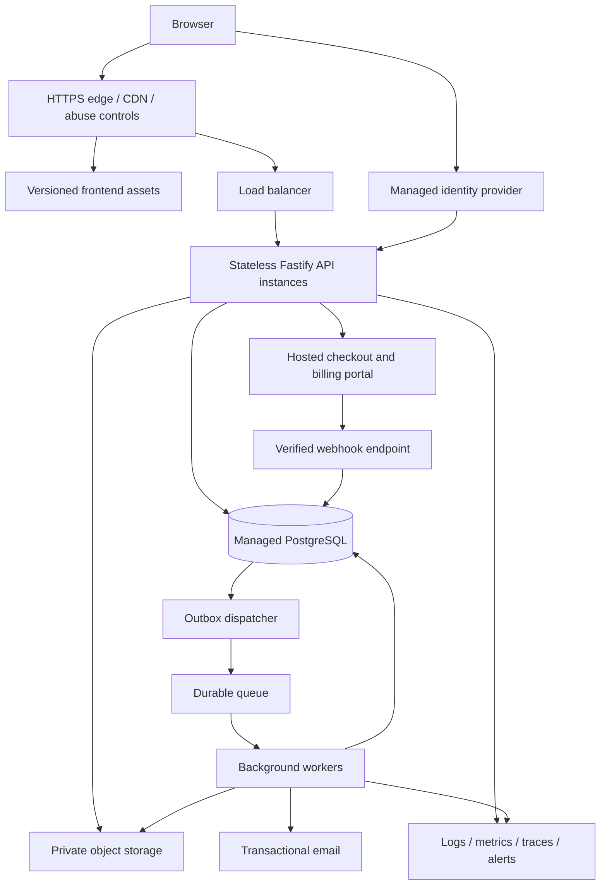

# Recall: six-month roadmap from local app to hosted service

**Written:** 18 October 2026. **Planning window:** 19 October 2026–18 April 2027, 26 weeks.

**Status:** proposed architecture and delivery plan, not implemented functionality. The current app remains local and single-user. Capacity figures, budgets, dates and service targets below are planning assumptions to validate, not measured promises.

**Reading guide:** [current app and gaps](#2-what-exists-what-changes-and-why) · [proposed architecture](#3-architecture-for-the-first-paid-release) · [data isolation](#4-data-ownership-and-account-isolation) · [payments](#7-payments-and-commercial-behavior) · [scaling](#11-scale-from-evidence-not-registered-user-counts) · [costs](#12-cost-and-business-checks) · [26-week schedule](#13-the-six-month-delivery-plan) · [first tickets](#15-first-implementation-tickets).

## 1. The recommendation

Build a paid, browser-based Recall service by keeping the existing React interface and study logic, then replacing the single-user server assumptions with authenticated, isolated accounts. Start with one application codebase, managed PostgreSQL, private object storage, background workers and managed login/payment providers. Deploy in one region first and deliver static assets worldwide through a CDN.

The first six months should produce a secure, recoverable paid service with evidence that people want to keep using it. Worldwide adoption requires continued product work, support and operations after that. A six-month project cannot establish unlimited capacity or compliance in every country.

**The critical order is: ownership and isolation → reliable persistence → accounts → safe file handling → billing → recovery and performance → controlled launch.** Do not expose today's server to the internet and put a login page in front of it. Authorization has to protect every API operation, media request, import, export and background job.

### Working assumptions

| Decision | Starting assumption | Why |
| --- | --- | --- |
| Audience | Individual university students, initially adults | Matches the existing product and limits initial account/team complexity |
| Product | Hosted web app with responsive mobile UI | Reuses the current interface; no app-store release required |
| Team | Two full-time engineers, founder/product time, part-time design/QA, and external security/legal/tax help | The roadmap includes operations and commercial work, not only coding |
| Launch geography | EU-first; initial paid countries explicitly approved | Start with a manageable support, tax and privacy footprint |
| Primary region | EU region, provisionally AWS Frankfurt | A concrete deployment target; confirm customer and vendor requirements before provisioning |
| Tenancy | One personal workspace per account; no sharing in v1 | Makes ownership explicit while leaving room for future organization features |
| Offline behavior | Local edition stays offline; hosted edition initially requires connectivity | Two-way offline synchronization is a separate substantial project |
| Monetization | One simple paid plan, with a trial or limited free tier chosen through research | Easier to explain, support and reconcile |

If one person is doing this part-time, extend the schedule or reduce the launch scope. Do not compress account isolation, payment correctness or recovery tests to meet the date. Reserve roughly 20% of delivery capacity for defects, migration surprises and user feedback.

`PRODUCT.md` and `docs/HANDOFF.md` describe a product with no cloud, accounts or telemetry. This proposal intentionally introduces a separate hosted offering in response to the new direction. Record that decision before implementation, and update hosted marketing/help text so it no longer claims that nothing leaves the computer. Do not silently upload local users' libraries.

## 2. What exists, what changes, and why

This inventory comes from the repository, rather than assuming Recall is a generic new SaaS project.

Primary code references: [server context](../server/context.ts), [database schema](../server/db/migrations.ts), [API/security setup](../server/app.ts), [routes](../server/routes.ts), [study transactions](../server/services/sessions.ts), [media storage](../server/services/media.ts) and [backup/restore](../server/services/backup.ts).

| Area | What exists today | Hosted requirement and reason |
| --- | --- | --- |
| UI | React, Vite, React Query, accessible keyboard flows, responsive light/dark layouts | Keep these; add account, connection, billing and recovery states |
| Study engine | Pure scheduling, queue, date and exam-planning logic in `shared/` | Reuse and retain deterministic tests; hosting does not require a new learning algorithm |
| API | Fastify, Zod validation and services in `server/` | Keep Fastify; introduce request-scoped identity and authorization |
| Persistence | Synchronous `better-sqlite3`, WAL, foreign keys and migrations | Hosted PostgreSQL with asynchronous access and explicit transaction boundaries; keep SQLite for the local edition |
| Ownership | `server/context.ts` has a database and config, but no authenticated user/workspace | Every private operation must have an authenticated actor and verified workspace |
| Network security | Loopback-only binding, local Host/Origin checks and `X-Recall-Client` | HTTPS, secure login sessions, CSRF protection, public origin configuration and trusted proxy boundaries; the custom header is not authentication |
| Study sessions | Revision checks, idempotent rating logic, database transactions | Preserve these guarantees across concurrent requests and multiple API instances |
| Open-session limit | `idx_sessions_one_open` allows one open study session in the entire database | Scope the rule to a learner and workspace so two users can study independently |
| Files | Local disk; `/media/:filename` has filename validation but no user ownership check | Private object storage and authorization before upload/download |
| Deduplication | `saveMedia` looks up content hash globally | Scope deduplication to a workspace; avoid cross-account content-existence leaks |
| Backup/restore | ZIP validation, SQLite snapshots, full restore deletes/reinserts application tables | Hosted imports must affect only the caller's workspace; platform disaster recovery becomes an operator function |
| Settings/drafts/demo | Designed around a single local library | Separate user preferences, workspace settings and operator config; scope draft, demo and undo operations |
| Search | SQLite FTS5 plus existing search behavior | PostgreSQL search with tenant filters and Unicode/language acceptance tests |
| Maintenance | `server/index.ts` runs a periodic backup timer in the API process | Dedicated scheduled jobs with leases/idempotency, so adding instances does not duplicate work |
| System endpoint | `/api/system` returns filesystem paths and runtime information | Remove from the customer API; expose only approved account diagnostics |
| Quality | Existing unit/API suites and Playwright walkthrough | Add real PostgreSQL, multi-user, billing, deployment and failure tests |
| Delivery | Local npm build/start scripts; no checked-in production cloud pipeline found | Containers, infrastructure as code, isolated staging/production and repeatable deployment |
| Commercial operations | No identity, payments, entitlement model or support console | Add managed identity, provider-backed billing, account lifecycle and support procedures |

During the preceding local setup work, the production build, 113 tests and browser walkthrough passed on Ubuntu with Node 24. That is a useful regression baseline, not evidence of hosted security or load capacity.

### Local features that cannot be exposed unchanged

- Full-database restore and snapshot listing/download.
- User-configurable filesystem backup paths and `/api/system` internals.
- Global settings, global demo cleanup and global open-session queries.
- Media download authorized only by knowledge of a filename.
- Searches, hierarchy lookups, undo tokens and bulk mutations that accept IDs without checking ownership.
- In-memory archive processing sized for a local machine: the current backup limits allow a 1 GiB archive and 2 GiB of expanded content, with synchronous ZIP processing. Hosted limits and worker memory budgets must be designed together; these defaults are unsuitable for unrestricted concurrent HTTP requests.

Create an endpoint inventory and classify every route as public, authenticated, workspace-scoped, operator-only or local-only. A route without a classification stays disabled in hosted mode.

## 3. Architecture for the first paid release

Use a **modular monolith**: one application with clear internal modules, deployed as API and worker processes. This keeps transactions and debugging understandable while allowing expensive jobs to scale separately.



The arrows show dependencies, not unrestricted network access. The identity callback exchanges a verified authorization code; it does not accept arbitrary user claims from the browser.

### Concrete default deployment

This is an implementation recommendation, not a claim that these are the only suitable vendors. Confirm regional availability, contract terms, pricing and team familiarity in week 1.

| Function | Proposed starting choice | Reason / tradeoff |
| --- | --- | --- |
| DNS, TLS and asset delivery | Managed DNS, certificates, CloudFront, private asset bucket | Worldwide delivery of JS/CSS/fonts; API responses and private files need separate cache rules |
| API and worker compute | ECS on Fargate, immutable Node 24 containers | Avoid maintaining VM operating systems; AWS networking/IAM still requires expertise |
| Routing | Application Load Balancer; only the intended edge can reach the public origin | Health-based routing, controlled deployment and a defined trust boundary |
| Database | RDS PostgreSQL; Multi-AZ before paid public launch | Managed failover and backups; still requires query design, capacity planning and recovery drills |
| Files | Private S3 buckets for media, import staging and exports | Survive container replacement and scale independently of compute |
| Background work | SQS plus a dead-letter queue and PostgreSQL job/outbox tables | Durable delivery, bounded retries and observable failure |
| Identity | Cognito managed login, standard OIDC integration | Outsource credentials and recovery; validate usability and account export/exit options |
| Payments | Stripe Checkout, Billing and Customer Portal, subject to business eligibility | Avoid collecting card data in Recall and building a billing UI from scratch |
| Operations | CloudWatch/OpenTelemetry, secrets manager, workload IAM roles | Central observability and short-lived workload credentials |
| Delivery | GitHub Actions with OIDC, container registry, Terraform | Reproducible environments without permanent cloud keys in CI |

Fargate runs containers without managing EC2 servers, but task resources, networking and scaling remain your responsibility. An RDS Multi-AZ **DB instance** standby provides failover, not read scaling; a read replica is a separate decision. [Fargate documentation](https://docs.aws.amazon.com/AmazonECS/latest/developerguide/AWS_Fargate.html), [RDS Multi-AZ documentation](https://docs.aws.amazon.com/AmazonRDS/latest/UserGuide/Concepts.MultiAZ.html).

If nobody on the team can operate AWS confidently, choose a managed application platform with managed PostgreSQL and private object storage instead. Evaluate it against the same isolation, backup, residency, export and deployment requirements. Spend one week choosing; avoid spending a month comparing vendors. Avoid Kubernetes, a service mesh, Kafka and multiple clouds for the first release.

### Repository boundaries

Keep `src/` and `shared/`; introduce boundaries incrementally instead of first reorganizing every file:

```text
server/auth/             login callback, application sessions, authorization
server/modules/          library, study, imports, billing, account lifecycle
server/db/postgres/      hosted repositories, transactions and migrations
server/db/sqlite/        local adapter, retaining current local behavior
server/storage/          local filesystem and private object-store adapters
server/jobs/             durable jobs, outbox dispatcher and worker entrypoint
infra/                   infrastructure definitions and environment configuration
tests/integration/       PostgreSQL, ownership, concurrent writes and billing
docs/runbooks/           deployment, rollback, incidents, restore and deletion
```

Introduce repository interfaces around meaningful operations such as `rateCard`, `saveDraft` and `importWorkspace`, rather than a generic SQL wrapper. SQLite SQL does not become PostgreSQL-compatible by swapping a package: transactions, placeholders, FTS, booleans, timestamps and concurrency behavior all need work. Convert service call chains to async and keep cloud migrations separate from existing local SQLite migrations.

Hosted mode must fail startup if identity, database or required security configuration is missing. It must never fall back to an unauthenticated local mode. Container binding to `0.0.0.0` is appropriate only inside the configured private deployment network; preserve the local edition's loopback refusal.

## 4. Data ownership and account isolation

A tenant is the boundary around a customer's private data. In v1, that is a personal workspace. The login identity and the workspace are separate records, even when the relationship is one-to-one.

### Proposed data model

| Records | Important keys and ownership |
| --- | --- |
| `users` | Internal ID; unique `(identity_issuer, identity_subject)`; account status. Email is changeable and is not the identity key |
| `workspaces`, `workspace_memberships` | Workspace ID, owner/member user, membership status and role; initially only one owner and no invite UI |
| Programs, semesters, courses, sections, notes, templates, cards, tags | Mandatory `workspace_id`; parent links must remain within that workspace |
| Schedules, review events, study sessions, session cards | Workspace plus learner `user_id`; progress belongs to the learner |
| Drafts and action undo records | Workspace, user, resource and revision; expiring undo tokens cannot cross account boundaries |
| Media | Workspace, asset ID, generated object key, bytes, checksum, processing state and references |
| Preferences | User-level timezone/accessibility; workspace-level organization; server config is separate |
| Auth sessions | Hashed random session token, user, expiry, revocation metadata; distinct from study sessions |
| Billing accounts, subscriptions, entitlements | Workspace owner and provider IDs; no card numbers or card security codes |
| Webhook inbox, outbox and jobs | Provider event/job ID, workspace where applicable, state, attempts and timestamps |
| Security audit events | Actor, action, target IDs, time and outcome; no flashcard text or secrets |

If collaborative libraries are added later, content permissions and learner-private progress need separate policies. Membership in a shared workspace must not automatically expose another learner's drafts or study history. The initial schema leaves room for this; the six-month plan does not implement collaboration.

### Enforcement rules

1. Resolve the user from a verified application session. Resolve the requested workspace through active membership. A client-supplied workspace ID is only a selector, never proof of access.
2. Build immutable request context containing the actor, verified workspace and a transaction handle. Never store the active workspace in the existing global `Ctx` object.
3. Require ownership predicates in repository operations, including search, counts, autocomplete, exports and bulk actions. Reject mixed-ownership bulk requests atomically.
4. Add database constraints that prevent cross-workspace relationships. A card's `(workspace_id, section_id)` must reference a section's `(workspace_id, id)`.
5. Add PostgreSQL row-level security (RLS) as a second boundary, not as a replacement for application authorization. Apply policies to all relevant tables and test real application roles.
6. Put the verified scope in transaction-local database settings on the same connection used for the queries. A pooled connection must not retain another request's tenant context. Missing scope must fail closed.
7. Scope cache keys, object keys, jobs, deduplication and rate limits too. Clear React Query caches and local account-specific state when logging out or switching accounts.

These boundaries address the cross-tenant risks described in the [OWASP multi-tenant guidance](https://cheatsheetseries.owasp.org/cheatsheets/Multi_Tenant_Security_Cheat_Sheet.html). PostgreSQL owners and `BYPASSRLS` roles can bypass RLS; use a non-owner runtime role without that attribute, restrict privileged functions, and keep migrations/operator recovery on separate roles. `FORCE ROW LEVEL SECURITY` can subject owners to policies but does not constrain superusers. [PostgreSQL RLS documentation](https://www.postgresql.org/docs/current/ddl-rowsecurity.html).

Audit migrated SQL views as well as tables. Recall already has `card_ctx` and `section_ctx` views; a PostgreSQL view can apply the owner's permissions and RLS policies by default. Where appropriate, use `security_invoker` views and test access through the actual view, not only its underlying tables. [PostgreSQL view security](https://www.postgresql.org/docs/current/sql-createview.html).

Illustrative constraints, to adapt during schema design:

```sql
-- Referenced tables also need UNIQUE (workspace_id, id).
ALTER TABLE cards ADD CONSTRAINT cards_section_same_workspace
  FOREIGN KEY (workspace_id, section_id)
  REFERENCES sections (workspace_id, id);

CREATE UNIQUE INDEX one_open_session_per_learner
  ON study_sessions (workspace_id, user_id)
  WHERE is_open = true;

CREATE UNIQUE INDEX rating_retry_key
  ON review_events (workspace_id, user_id, idempotency_key);
```

Scope other uniqueness rules too: tag names, draft keys, note variants and media hashes. Prefer indexes that match actual access patterns, for example `(workspace_id, user_id, due_date, card_id)` for scheduled cards and `(workspace_id, user_id, rated_at)` for review history.

### Correctness under simultaneous use

PostgreSQL will allow concurrent operations that SQLite's single writer previously serialized. Audit the entire transaction, including reads performed before a write.

For a rating: authenticate → authorize session → begin transaction → lock the session row → check scoped idempotency key and request payload hash → enforce expected revision/current card → write rating, schedule and queue → commit → return the saved result. If another learner operation can touch the same schedule, lock or conditionally update that schedule too, with a consistent lock order.

Make expected revisions mandatory for hosted mutations that depend on current state. A repeated key with identical input returns the prior result; reuse with different input returns a conflict. A network timeout after commit must not cause a second rating. Undo must check revisions and ownership and must not overwrite a subsequent edit from another device.

Keep authoritative study reads and writes on the primary database. Eventual consistency is acceptable for a delayed analytics chart, not for which card appears next.

## 5. Login, sessions and security

Use managed identity with an authorization-code flow and PKCE. The Fastify backend handles the callback, validates state/nonce and token issuer/audience/expiry, and creates its own opaque application session. Use a maintained OIDC library; do not implement token verification or password recovery from scratch. Cognito documents its code-flow and PKCE behavior in the [authorization endpoint reference](https://docs.aws.amazon.com/cognito/latest/developerguide/authorization-endpoint.html).

Store the browser session in a `Secure`, `HttpOnly`, appropriately scoped `SameSite` cookie. Keep provider refresh tokens server-side if needed. Rotate sessions after login and sensitive changes, enforce idle/absolute expiration, and support logout-all-devices. Require reauthentication for deletion, email changes and billing changes. Protect cookie-authenticated mutations with CSRF defenses and origin checks. Do not put bearer credentials in localStorage. [OWASP session guidance](https://cheatsheetseries.owasp.org/cheatsheets/Session_Management_Cheat_Sheet.html).

Account flows must cover verified email, signup abuse, sign-in failure, forgotten credentials, identity-provider downtime, account recovery, deletion and safe linking of additional login methods. Never merge accounts merely because a browser claims the same email. Require MFA for operators; make stronger authentication available to users as supported by the selected provider.

Implement deletion as a durable, retryable workflow across systems: mark the account as deleting and block new work, revoke sessions, stop future subscription renewals under the published policy, cancel queued work, remove content/media, and remove or disable the identity-provider account. Retain only records required by the documented legal/security policy. A late billing webhook or worker retry must not recreate the deleted workspace. Report completion only after the required steps finish; alert on stuck deletions.

### Threats to test before external beta

| Threat | Required protection and proof |
| --- | --- |
| Guessing another user's card/session IDs | Every route checks ownership; A/B-account tests cover reads and writes |
| Private image/export leaks | Authorized download, private buckets, tenant scope and correct cache rules |
| Login/session theft | Secure cookies, rotation, recovery checks, MFA for operators and secret-redacted logs |
| Forged paid status | Server-side entitlement checks and verified payment webhooks |
| Resource exhaustion | Per-route size/time limits, pagination, per-account quotas and bounded worker concurrency |
| Malicious imports/images | Quarantined processing with memory/CPU/file-count limits and no outbound fetches |
| Abuse of operator access | Least privilege, time-limited access, audit trail and explicit support-access policy |
| Dependency compromise | Lockfiles, dependency/container scanning, pinned CI actions and prompt patching |

Configure the reverse-proxy trust chain explicitly; do not trust arbitrary forwarded headers. Set expected public host/origin values from deployment configuration. Disable shared caching for authenticated API responses, and prevent authenticated HTML or signed downloads being reused across users. Treat CSP changes for authentication/payment redirects as narrow allowlist changes, not a reason to allow arbitrary scripts.

Use separate cloud accounts or equivalent hard boundaries for production and non-production. No production libraries in preview deployments. Use workload identities, least-privilege IAM, encrypted transport/storage, secrets management and audited rotation. Configure budget and abuse alarms so a signup or export attack cannot create an unnoticed bill.

## 6. Media, import/export and migration from local Recall

### Hosted media pipeline

1. The API verifies ownership and available quota, then reserves an upload with a generated staging key.
2. The client uploads to a private quarantine location through a constrained, short-lived grant. Enforce upload size at the gateway or upload-policy layer and verify it again after upload.
3. A worker verifies bytes, image dimensions, format and decompression limits; re-encodes allowed images in a restricted process where appropriate. Scan supported archives/files according to the threat model.
4. Publish a validated immutable object/version and a database asset record only after successful processing. Cards cannot reference another workspace's assets or unvalidated uploads.
5. Downloads require authorization. Start with an authorized media endpoint; introduce short-lived signed downloads when needed. Expiry and revocation limitations must be understood.

Presigned S3 URLs are reusable until expiry and can overwrite the named object. Therefore do not treat them as one-use credentials or let an upload URL target a final immutable object. Copy a validated version into a separate final key before marking it ready. [S3 presigned URL behavior](https://docs.aws.amazon.com/AmazonS3/latest/userguide/using-presigned-url.html).

Keep existing MIME checks, but add full decoding and resource limits: a correct image signature alone does not establish safety. Cap upload rates, bytes, archive entries, expanded archive size and per-workspace storage. [OWASP file-upload guidance](https://cheatsheetseries.owasp.org/cheatsheets/File_Upload_Cheat_Sheet.html).

Do not persist expiring signed URLs inside Markdown. Persist asset IDs or stable application URLs. Account deletion and garbage collection must cover originals, thumbnails, staging files and exports, while respecting the documented backup retention window.

### Safe local-to-cloud import

Use the existing full export format as the initial migration boundary; never require uploading an arbitrary live SQLite database to the production API.

1. The user explicitly exports a local backup and signs in to the hosted account.
2. Upload to quarantine; validate schema version, references, counts, archive limits and media.
3. Show a preview of programs, cards, schedules, history, media and unsupported fields.
4. Map all imported identities to the authenticated target workspace and learner. Do not trust ownership, billing, permissions or paths in an archive.
5. Remap IDs and `/media/` references consistently. Preserve supported card types, notes/templates, schedule dates, review history and drafts; explain anything that cannot migrate.
6. Stage media first, then publish the imported library through a transaction or an atomic library-version switch. Do not expose partial imports; clean abandoned staging asynchronously.
7. Verify counts, relationships, sample content, due dates and media hashes. Return an import receipt and make retries idempotent.
8. Keep the original local backup unchanged. The user can continue using the local edition independently.

An imported open session must either migrate with all required state or be explicitly closed during preview with the user's consent; do not silently lose progress. Timezone mappings must preserve calendar due dates rather than reinterpret them as UTC timestamps.

Cloud export is a scoped background job with an expiring private download. Start cloud import with “create/add a library”; defer destructive workspace replacement until it has its own rollback design. Today's global restore function is forbidden in hosted customer routes.

No ongoing local/cloud synchronization in this roadmap. A later sync project needs operation IDs, tombstones, conflict policy, offline authentication expiry and a rule for contradictory offline ratings. Merely adding a service worker does not solve those problems.

## 7. Payments and commercial behavior

### Decide the seller model before integrating checkout

Default assumption: the business is the seller and uses Stripe for subscriptions. Evaluate a merchant-of-record arrangement during month 1 if reducing international indirect-tax administration is a priority. Compare contractual responsibility, supported countries/products, fees, refunds, customer-data portability and migration costs; do not integrate two payment systems in parallel.

Hosted checkout reduces Recall's exposure to payment-card data. It does not by itself settle business registration, tax, consumer terms or all payment compliance responsibilities. Record who handles registrations, collection, invoicing, returns and remittance for each initial market. Stripe's tax tooling includes several distinct services; choose and configure the required ones with an accountant. [Stripe Tax documentation](https://docs.stripe.com/tax).

### Subscription implementation

- Create checkout server-side using an allowlisted price ID and the authenticated billing owner. Never trust a browser-supplied amount, customer ID or “paid” flag.
- Use provider idempotency keys for creation requests and prevent concurrent duplicate subscriptions.
- Store provider customer/subscription IDs and a local entitlement record. Authorize premium actions on the server, including worker jobs and storage reservations.
- Show a pending state after checkout until authoritative billing state is reconciled. The checkout success redirect is not proof of payment.
- Support trial expiry, renewals, failed payments, cancellation at period end, upgrades/downgrades, refunds and disputes.
- Define what happens when a plan expires: for example, stop new uploads beyond quota while retaining read/export access. Do not delete learning history merely because a payment failed.
- Keep legal deletion/export rights independent of paid feature gates, and document a fair retention/grace policy.

Subscription status and payment outcomes have a lifecycle; map the provider's documented states to an explicit entitlement policy instead of checking a single boolean. [Stripe subscription lifecycle](https://docs.stripe.com/billing/subscriptions/overview).

### Webhook reliability

Verify signatures against the raw request bytes and the correct environment secret. Webhooks need a dedicated public endpoint that does not require a user cookie or the current `X-Recall-Client` header. Exempt only that endpoint from browser CSRF checks and replace them with provider verification.

Persist a verified event in a durable inbox with a unique provider event ID, then acknowledge it. Process asynchronously with retries, deduplication and reconciliation against current provider state. Duplicate or out-of-order delivery must not double-grant benefits or reactivate a canceled plan. Track inbox age and failures. [Stripe webhook guidance](https://docs.stripe.com/webhooks).

Run periodic reconciliation of local subscriptions against the provider. Billing outages should preserve recently verified access for a bounded, documented grace period, while preventing unverified new upgrades. Test missed webhooks, replay, payment requiring extra authentication, renewal failure, cancellation and refund before accepting real customers.

## 8. Background work and reliable deployment

Move imports, exports, image processing, account deletion, billing reconciliation and aggregate statistics into workers. A request should create a job and return its ID; the UI can poll progress initially. WebSockets are unnecessary for that first version.

Use a transactional outbox when a database change must trigger a job: write the domain state and outbox row in one transaction, then have a dispatcher send the job. This closes the failure gap between “database committed” and “queue message sent.”

Assume delivery can repeat. Jobs need a stable ID, validated workspace scope, bounded exponential backoff, a lease/visibility timeout, cancellation behavior and a dead-letter path. Check current authorization/account state before user-triggered work starts. A worker must survive termination after the side effect but before acknowledgment. Standard SQS explicitly provides at-least-once delivery. [SQS delivery documentation](https://docs.aws.amazon.com/AWSSimpleQueueService/latest/SQSDeveloperGuide/standard-queues-at-least-once-delivery.html).

Rate limits and scheduling locks must work across API/worker replicas. Begin with gateway controls plus database-backed atomic quotas where adequate; introduce a shared Redis-compatible store only if measured load justifies it. Keep correctness in PostgreSQL even if a cache disappears.

### Deployment sequence

1. PR: typecheck, unit tests, PostgreSQL integration tests, ownership tests, build and relevant browser tests; scan dependencies, secrets and image.
2. Build one immutable container/image and asset bundle identified by commit SHA. Run non-root with bounded resources and a read-only root filesystem where practical.
3. Apply infrastructure through reviewed code; CI receives short-lived permissions through OIDC.
4. Run additive schema migrations once as a controlled job. Do not run destructive migrations on every API boot.
5. Deploy staging, exercise representative flows and verify dashboard/alerts.
6. Release a small production canary, watch error rate, latency and queue lag, then expand or roll back.
7. Retain previous application/assets until old tabs and rollback windows are covered. `index.html` must not point to deleted bundles.

Use expand/contract migrations: add new fields, deploy code that tolerates both representations, backfill with checks, switch reads, and remove old fields in a later release. Application rollback must work with the migrated schema. Restoring the whole production database is not a routine code rollback because it can discard other users' new work.

Add separate liveness and readiness endpoints. Liveness checks the process; readiness checks whether it can serve requests. Do not restart every instance because an optional payment/email provider is down. On shutdown, drain HTTP requests, stop claiming jobs and close database pools cleanly.

## 9. Reliability, recovery and support

### Initial engineering targets

These become customer commitments only after measurement and an operations review.

| Measure | Target before public paid launch | How to prove it |
| --- | --- | --- |
| Core API availability | 99.9% successful eligible requests over a rolling 30 days | Request metrics plus external synthetic sign-in/study checks; define eligible requests and exclusions |
| Save/rating latency | p95 < 400 ms and p99 < 1 s server-side under agreed launch load | Load tests with real PostgreSQL and production-like data |
| Nearby user experience | p95 save/rate completion < 1 s from initial market | Browser measurements including network latency; track distant regions separately |
| Correctness | No duplicate rating effects or cross-account access in acceptance tests | Concurrent retries, A/B-account tests and failure injection |
| Routine database recovery | RPO ≤ 5 minutes; RTO ≤ 60 minutes | Restore to an isolated environment and compare committed records |
| Regional disaster | Initially RPO ≤ 24 hours, RTO ≤ 8 hours, only if approved cross-region backups and drills support it | Full rebuild/restore/routing exercise; otherwise explicitly document this as unmet |
| Job health | Ordinary job-start delay p95 < 60 s at planned load | Queue age and worker metrics; large exports have separate completion targets |

RPO is the maximum acceptable lost time of data; RTO is the time allowed to restore service. Define them separately for PostgreSQL, media, authentication and billing recovery. A five-minute database backup target does not prove five-minute recovery of uploaded images. A 99.9% time-based monthly availability target allows about 43 minutes of downtime in a 30-day month; the request-based SLO above needs its own error-budget calculation.

### Recovery design

- Enable managed database point-in-time recovery with documented retention, initially targeting 30 days where supported and affordable.
- Version media and prevent the web application role from deleting backup versions. Retain immutable assets long enough to restore database references consistently.
- Keep encrypted backup copies under separate credentials/account controls; add an approved second region for regional disaster recovery.
- Restore database and media into an isolated environment, reconcile asset references and verify representative libraries before routing traffic.
- For one customer's accidental deletion, restore a copy and extract only that tenant's data through a reviewed tool. Never overwrite the live shared database to recover one user.
- Test restoration monthly and after storage/migration changes. Record duration, recovered timestamp, integrity checks and missing objects.
- Reapply deletion tombstones after recovery so restoring a backup does not resurrect accounts previously erased.

RDS point-in-time recovery creates a new DB instance. Recovery procedures must therefore include configuration, credentials/access, endpoint changes and application verification, rather than assuming a restore rewinds the live database in place. [RDS point-in-time recovery](https://docs.aws.amazon.com/AmazonRDS/latest/UserGuide/USER_PIT.html).

### Operations people must actually perform

Assign a primary incident owner and a backup, define coverage hours, and document escalation beyond those hours. A global service can fail while the founder sleeps. Do not advertise 24/7 support without staffing it.

Create runbooks for API outage, database failover, queue backlog, billing mismatch, suspected data leak, compromised credentials, failed deployment and account recovery. Include detection, containment, owner, recovery command/process and verification. Run an incident exercise before public launch.

Collect request IDs, route/status/latency, database pool wait, slow queries, error rates, worker lag, billing reconciliation lag, backup freshness and spending. Redact card content, answer text, cookies, auth codes, payment details and signed URLs. Limit high-cardinality metrics; use protected logs for scoped diagnostics. Support staff should initially see account/billing/job metadata, not study content.

## 10. Privacy and international readiness

Prepare a data inventory covering identity, email, study content, review history, uploaded images, billing IDs, audit events and support records. State purpose, access, processing location, retention and deletion behavior for each category. Hosting in an EU region alone does not settle international transfers through identity, billing, email, analytics or support vendors.

Before paid launch, obtain jurisdiction-specific review of privacy notice, terms, consumer subscription/cancellation behavior, tax/invoicing, processor contracts and transfer arrangements. Review age eligibility and obligations before admitting minors or selling to schools. Assess whether a DPIA or other additional obligations apply; do not assume every SaaS has the same requirements. GDPR principles include minimization, storage limitation and appropriate safeguards. [European Commission GDPR principles](https://commission.europa.eu/law/law-topic/data-protection/information-business-and-organisations/principles-gdpr_en).

Implement export and deletion workflows with identity verification, tracked jobs and explicit handling of legal billing retention. Maintain a breach assessment log and response process: notification to a supervisory authority may be required within 72 hours of awareness when the breach presents the relevant risk; high-risk cases can also require communication to affected people. Confirm applicability during an incident with qualified advice. [EDPB small-business guidance](https://www.edpb.europa.eu/sme/find-practical-info/faq_en?page=1).

For international usability, preserve per-user IANA timezones and DST-safe calendar scheduling, externalize UI strings, test Unicode and long text, and choose localization based on actual customers. Start with a small supported-language set. Measure overseas latency before adding another database region. Expand payment methods and currencies only after pricing, tax and support processes are ready.

Operational monitoring is necessary for a hosted service; product analytics is a separate decision. Collect the minimum needed to measure activation/retention, document the purpose and legal basis, and avoid recording card contents. Add consent controls where required. Do not reuse the local edition's “no telemetry” claim for a hosted product with analytics.

## 11. Scale from evidence, not registered-user counts

Registered accounts do not tell you the workload. Track daily active users (DAU), simultaneous learners, requests per active learner, ratings per day, media bytes and job duration.

### Example capacity model

Assume 10,000 DAU, 2% simultaneously studying at peak, and one API request every five seconds per active learner across reveal/rate/save/navigation:

```text
Concurrent learners = 10,000 × 0.02 = 200
Steady peak API load = 200 / 5 = 40 requests/second
Initial burst test   = 3 × 40 = 120 requests/second
```

These are test inputs, not a statement that a selected instance size can handle that traffic. Validate the request mix against real behavior; large imports, polling and dashboard queries can dominate it. At 50 saved rating events per DAU, that same scenario produces 500,000 review rows/day, roughly 15 million/month. Model event size, indexes, retention and export cost before committing to unlimited history.

Build a repeatable load suite with realistic distributions: many small libraries, a few very large libraries, skewed tenant activity, large history tables, image traffic, retries and concurrent exports. Seed millions of rows as the target scenario requires. Test a sustained peak, a burst, an extended soak and a dependency slowdown. Measure database CPU/I/O, lock waits, pool wait, event-loop delay, memory and queue age—not only HTTP throughput.

### Scaling ladder

| Evidence | Next action | Why / constraint |
| --- | --- | --- |
| First 20–50 invited testers | One small staging/beta stack; measure behavior and fix correctness | Learn cheaply before purchasing capacity |
| Paid public launch | At least two API instances across availability zones, separate worker, managed DB failover, tested backups | Survive an instance or zone failure without requiring multi-region writes |
| Slow endpoints and high database time | Inspect query plans, add scoped indexes, paginate and remove N+1 queries | Extra API replicas do not fix inefficient database access |
| API CPU/event-loop pressure while DB has headroom | Scale API instances and separate CPU-heavy work | Stateless instances can be replaced without losing progress |
| Connection saturation | Tune bounded pools and max replica count; evaluate a compatible pooler | Autoscaling must not exhaust PostgreSQL connections |
| Export/import backlog | Add workers within database and storage budgets; per-tenant fairness | One large customer should not delay everyone's work |
| Expensive repeated read queries | Cache safe derived data with tenant/version keys and bounded staleness | Study mutations and permissions still use authoritative state |
| Analytics traffic competes with study writes | Precompute aggregates; consider a read replica for tolerant reads | Replica lag must not affect study correctness |
| Review tables cause measured maintenance/query problems | Evaluate time partitioning, archival and index strategy | Partitioning adds operational and uniqueness complexity; it is not a user-count milestone |
| Strong demand and poor p95 latency in another region | Add a regional API/database deployment with workspace home-region routing | Each workspace keeps one authoritative writer |
| Single database reaches measured limits after tuning | Split workspace groups across databases with a routing directory | Shard by ownership boundary; retain transactional study operations within a shard |

Size connection pools against the worst case: `API replicas × pool size + worker pools + migration/admin reserve` must stay below safe database capacity. Set autoscaling maximums and queue concurrency from that budget. Use overload backpressure and `429`/`Retry-After` for abusive or excessive work instead of allowing unbounded memory growth.

### Going global after the first launch

A CDN helps static assets; it does not remove the round trip for a rating committed in Frankfurt. Establish regional latency dashboards and business demand first. Then choose another region, provision the same infrastructure, assign new workspaces a home region and plan explicit migrations for existing ones.

Regional moves need a write freeze or controlled replication/cutover, verified row/media counts, routing update, session handling and a rollback boundary. Never allow both regions to independently accept ratings for the same workspace without a conflict-safe design. Do not introduce active-active database writes during the first six months.

## 12. Cost and business checks

The following are **planning allowances in EUR, not vendor quotes**. They assume small initial usage, a non-production environment, monitoring/backups and increasingly resilient production resources. Payment fees, tax, salaries, support, legal/security work and marketing are excluded. Obtain a regional calculator estimate before purchasing; database redundancy, network gateways, egress and logs can change the result substantially. [ECS pricing](https://aws.amazon.com/ecs/pricing/), [RDS PostgreSQL pricing](https://aws.amazon.com/rds/postgresql/pricing/).

| Phase | Monthly infrastructure allowance | Budget action |
| --- | --- | --- |
| Months 1–2: development/private staging | €150–€400 | Shut down unnecessary preview resources and cap logs |
| Months 3–4: invited beta/billing validation | €400–€1,200 | Add production isolation, backups and operational tooling |
| Months 5–6: resilient paid launch | €800–€2,500 | Fund redundant API/DB resources, recovery copies and load tests |

At those assumptions, six months of infrastructure is roughly €2,700–€8,200 before contingency. Reserve at least 25% headroom, and revise after measured traffic. A free-tier prototype can cost less; this is not a budget for millions of active learners.

Staffing is likely the largest cost: this schedule assumes approximately 12 engineer-months across two people, plus founder/product and specialist time. Commission security review early enough to fix findings. Price legal/accounting support separately rather than hiding it inside cloud spend.

For a solo founder, use the same dependency order but plan for a secure private beta and a small paid pilot within six months, subject to progress. Prefer a platform you already know, postpone localization and growth infrastructure, and purchase focused security/operations review. Keep the ownership, billing and restore gates intact; extend the public-launch date if they are not met.

Track a monthly cost sheet for compute, database/storage/I/O, backups, egress, identity, email, observability and payment fees. Define upload/storage/export quotas and spend alerts before a public free tier.

```text
Net subscription revenue = collected subscriptions − tax − refunds − payment fees
Contribution              = net subscription revenue − variable hosting/support costs
Infrastructure break-even = fixed monthly infrastructure / contribution per paid user
```

For illustration only, €900 fixed infrastructure and €4 contribution per paid user needs 225 paid users just to cover that infrastructure; it does not pay salaries. Derive the contribution from actual pricing, usage and fees rather than treating all subscription revenue as profit.

Interview students before deciding what to charge for. Measure first-card/first-session activation, time to first completed session, week-1/week-4 retention, trial conversion, voluntary/involuntary churn and support burden. Segment around exam cycles. Do not spend heavily acquiring users until returning learners demonstrate value and the unit economics are understood.

## 13. The six-month delivery plan

The week numbers are sequential from 19 October 2026. Engineering owner A leads backend/data/security; owner B leads frontend/infrastructure/testing. Both review changes across boundaries. The founder owns research, commercial decisions and support; specialists advise and independently review. These are roles to assign to named people in week 1.

### Month 1 — foundations and explicit product decisions, weeks 1–4

**Outcome:** agreed hosted scope, a deployment foundation and a proven authenticated data slice.

| Week | Work | Evidence / exit condition |
| --- | --- | --- |
| 1 | Inventory routes/data; interview 5–10 target students; decide local vs hosted behavior, initial countries, seller model, budget and vendor shortlist | Written decisions, threat model, route classification and success metrics; no public deployment of the old API |
| 2 | Set up separate environments, CI, containers, infrastructure code, secret handling, logs and spend alerts | A repeatable staging deployment with synthetic data; rollback to previous image demonstrated |
| 3 | Design PostgreSQL ownership schema, request context and migration approach; implement a vertical slice for program → section → card | PostgreSQL integration test creates/reads a card within its workspace; cross-workspace access fails |
| 4 | Integrate managed login and opaque sessions; implement first RLS policies and membership checks | Two accounts log in and each sees only its own slice; missing tenant context fails closed |

**Gate:** approve the architecture only after the login/data slice and deployment are demonstrated. If the chosen provider creates disproportionate complexity, change it now, before migrating every module.

### Month 2 — safe multi-user core, weeks 5–8

**Outcome:** the existing learning workflows work independently for multiple people.

| Week | Work | Evidence / exit condition |
| --- | --- | --- |
| 5 | Port hierarchy, cards, notes/templates, tags and search to async scoped repositories | Local/PostgreSQL behavioral tests match; mixed-tenant IDs and bulk actions are rejected |
| 6 | Port scheduling, sessions, ratings, undo and statistics; add per-learner constraints | Parallel learners do not block each other's open sessions; retries and simultaneous edits preserve correctness |
| 7 | Port drafts/preferences/demo; add private object storage, upload quarantine and download authorization | Account A cannot retrieve B's media or draft; container replacement loses no saved content |
| 8 | Implement scoped background export/import, local backup migration and account cache clearing | Realistic local backups migrate with reconciliation receipts; no global restore route is reachable |

**Gate:** no invited external users until the route inventory is fully covered by authorization checks and automated A/B-account tests. Review application DB privileges and bucket permissions independently of code review.

### Month 3 — invited beta and operations, weeks 9–13

**Outcome:** 20–50 invited testers can study safely, and the team can diagnose and recover failures.

| Week | Work | Evidence / exit condition |
| --- | --- | --- |
| 9 | Complete signup/recovery/logout/revocation and account deletion/export; fix hosted error/loading/conflict states | Browser tests cover identity lifecycle and interrupted saves; deletion handles queued jobs |
| 10 | Set route quotas, worker limits, abuse controls, backup retention and restore automation | Restore a database/media copy and measure RPO/RTO; alarms reach the responsible person |
| 11 | Launch invite-only beta with clear beta terms, feedback channel and scoped operational monitoring | 20–50 invited accounts; first completed sessions and support issues reviewed daily |
| 12 | Improve onboarding, slow queries, large-library behavior and accessibility; start baseline load tests | Primary workflows pass keyboard/mobile checks; measured capacity report and query fixes |
| 13 | Review retention and defects; finalize initial pricing, trial, refund/cancellation and tax setup | Written beta findings, revised load assumptions and explicit go/no-go for billing work |

**Gate:** pause new invitations if correctness, ownership or recovery fails. Low retention calls for product changes, not more infrastructure. Schedule the external security review now if it is not already booked.

### Month 4 — payments and limited paid beta, weeks 14–17

**Outcome:** a small supported customer group can pay, cancel and retain control of their data.

| Week | Work | Evidence / exit condition |
| --- | --- | --- |
| 14 | Add billing schema, entitlements, checkout and account billing UI in provider test mode | Server refuses forged price/customer IDs; creating checkout twice cannot create duplicate intended purchases |
| 15 | Add verified durable webhooks, reconciliation, portal and grace/downgrade policy | Duplicate, delayed, reordered and missed events converge to correct access |
| 16 | Finalize initial-market terms/privacy/tax/invoices; test refunds, deletion and billing support | Commercial review complete; end-to-end test includes cancellation and failed renewal |
| 17 | Enable limited paid beta; reconcile provider and local records daily | Real payment lifecycle verified by the operator; no unexplained charges/access mismatches |

**Gate:** payment acceptance remains restricted to approved markets. Freeze new billing features if reconciliation cannot explain account state. Never use paying customers as the first test of webhook retries or refunds.

### Month 5 — resilience, security and launch capacity, weeks 18–21

**Outcome:** the service survives expected failures and has a measured operating envelope.

| Week | Work | Evidence / exit condition |
| --- | --- | --- |
| 18 | Independent security review covering tenant isolation, identity, uploads, billing and operator access | Written findings with owners and deadlines; immediately contain critical issues |
| 19 | Run realistic load/soak tests; tune queries, pools and queues; enable multi-instance API and DB failover | Capacity report states data size, workload, resources, p95/p99 and failure behavior |
| 20 | Exercise failed deploy, process/worker crash, database failover, billing outage and backup restoration | Runbooks used successfully by someone other than their author |
| 21 | Fix/retest findings; verify deletion, backup protection, regional recovery assumptions and supply-chain controls | No unresolved critical/high launch-blocking findings; recovery evidence and spending limits signed off |

**Gate:** do not advertise reliability targets until their drills pass. If independent review uncovers an architectural flaw, use the launch buffer and defer growth work.

### Month 6 — controlled public launch and next-stage plan, weeks 22–26

**Outcome:** a supported paid product with a measured plan for the next region and growth stage.

| Week | Work | Evidence / exit condition |
| --- | --- | --- |
| 22 | Finish public onboarding/pricing/help/status/support pages; establish launch cohort limits and incident coverage | New users can understand price, limits, cancellation and data handling without assistance |
| 23 | Launch to a small public cohort in approved markets; review activation, errors and cost daily | Stable service and billing reconciliation through at least one normal operating week |
| 24 | Expand admission gradually within tested headroom; begin small acquisition experiments | Cohorts show acceptable support load, retention and contribution economics |
| 25 | Measure international demand/latency; prioritize localization and second-region business case | Written recommendation to expand, stay single-region or focus on product retention |
| 26 | Perform final recovery/release review; publish internal SLO/capacity/cost report and next-quarter backlog | Named owners, tested runbooks, current diagrams and an evidence-based next stage |

**Month-six success means:** users can sign in, migrate/create content, study across devices while online, pay/cancel, export/delete data and get support; the team can deploy, detect failures and restore service. It does not require native mobile apps, collaboration, public deck sharing, offline sync, database sharding or active-active regions.

## 14. Definition of done and launch blockers

Use this checklist at each release gate; a calendar date does not override a failure.

- [ ] Every customer route, file and job has an ownership classification and enforcement test.
- [ ] Runtime database/storage roles cannot bypass the intended tenant boundary.
- [ ] Searches, counts, caches, drafts, demo deletion, media, undo, imports and exports pass cross-account tests.
- [ ] Concurrent ratings/retries/undo are safe on real PostgreSQL across two API instances.
- [ ] Login recovery, revocation, CSRF, account switching and operator MFA have been exercised.
- [ ] Checkout/webhooks/reconciliation/refunds/cancellation have been tested; entitlements are enforced server-side.
- [ ] Local migration preserves supported content and history with a verifiable receipt.
- [ ] Backup restoration, media reconciliation and deletion replay pass with measured recovery times.
- [ ] Load tests document a safe capacity limit, database connection budget and maximum worker/API scaling.
- [ ] Production deploy and rollback work without destructive database restoration.
- [ ] Critical/high launch-blocking security findings are fixed and independently retested.
- [ ] Alerts, incident ownership, status communication and customer support actually work.
- [ ] Initial-market commercial/privacy/tax obligations have assigned owners and completed reviews.
- [ ] Costs, quotas and abuse controls prevent an uncontrolled free-tier bill.

## 15. First implementation tickets

These are the starting backlog, in dependency order. They do not authorize spending, deployment or changing production systems by themselves.

1. **Hosted product decision record:** personal workspaces, initial countries, local-edition boundary, online-only hosted v1 and deferred features. Owner: founder + both engineers.
2. **Endpoint/security inventory:** enumerate routes and all global queries/filesystem operations, mark local-only functions, write the initial threat model. Owner: A.
3. **Reproducible staging:** container, CI checks, infrastructure definitions, synthetic data, short-lived CI credentials and budget alarms. Owner: B.
4. **PostgreSQL vertical slice:** workspace schema, membership, scoped card repository, composite foreign keys and real-database tests. Owner: A.
5. **Identity/session slice:** provider callback, secure application cookie, CSRF protection, logout and verified request context. Owner: B, reviewed by A.
6. **RLS/ownership test harness:** two users, pooled-connection reuse, missing-scope failures, ID substitution and background-job scope. Owner: A, reviewed by B.
7. **Study transaction migration:** asynchronous transaction boundary, locks/revisions, scoped retry keys and one-open-session constraint. Owner: A.
8. **Private media slice:** storage adapter, upload reservation/quarantine, validated publish and authorized download. Owner: B.
9. **Scoped import/export:** durable job foundation, local-backup adapter, reference mapping and verification receipt. Owners: A + B.
10. **Operational acceptance:** restore drill, request/job metrics, fault injection and launch dashboard. Owner: B with both engineers practicing recovery.

Finish the first authenticated vertical slice before porting every service. Keep architecture decisions and benchmark reports alongside this roadmap, and review the plan at each monthly gate against actual users, costs and failure evidence.
